# 01 入れる・起動する

Affinity Mapping Studio（AMS）をパソコンに入れて，初めて起動するまでの手順です．
画面の写真の赤い枠のところを，順に押していけば進めます．

- [どれをダウンロードすればよいか](#どれをダウンロードすればよいか)
- [Mac](#mac)
- [Windows（.exe）](#windowsexe)
- [Windows（.msi）](#windowsmsi)
- [新しい版に上げる](#新しい版に上げる)

[マニュアルの目次へ](README.md)

## どれをダウンロードすればよいか

ダウンロードは [Releases](https://github.com/YukiInoueNakata/affinity-mapping-studio/releases/latest) のページから行います．
開くと，いちばん新しい版（「Latest」の印が付いたもの）が出ます．

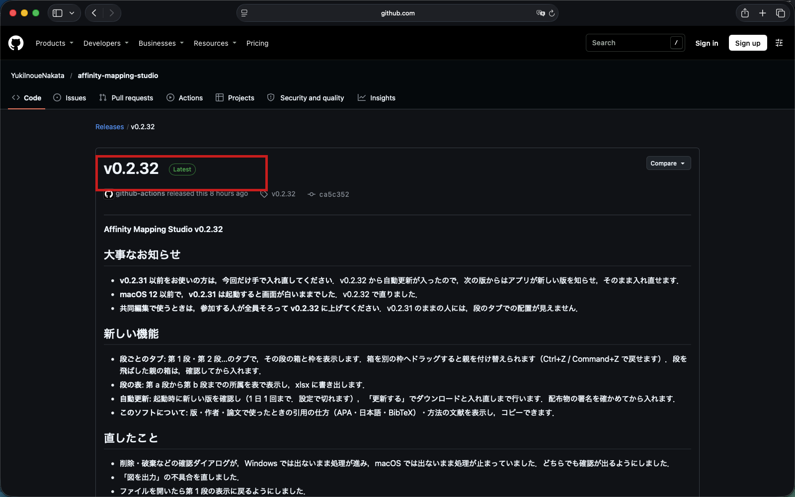

ページのいちばん下にある「Assets」の一覧から，自分のパソコンに合うファイルを 1 つ選びます．

| パソコン | 選ぶファイル | ファイル名の例 |
|---|---|---|
| Mac（Apple シリコンでも Intel でも同じ） | `.dmg` | `Affinity.Mapping.Studio_0.2.32_universal.dmg` |
| Windows（おすすめ） | `.exe` | `Affinity.Mapping.Studio_0.2.32_x64-setup.exe` |
| Windows（会社や大学で，管理者が配るとき） | `.msi` | `Affinity.Mapping.Studio_0.2.32_x64_en-US.msi` |

ファイル名の `0.2.32` は版の番号です．新しい版では数字が変わります．
一覧のほかのファイル（`.tar.gz`，`.sig`，`latest.json` など）は，アプリが自動で新しい版に上げるときに使うものです．ダウンロードする必要はありません．

## Mac

写真は macOS 26（Tahoe）のものです．macOS 15（Sequoia）以降は，ほぼ同じ手順です．
macOS 14 以前の場合は，[古い macOS の場合](#古い-macos-の場合)を見てください．

### インストール

1. Assets の一覧で `…_universal.dmg` を押します．

   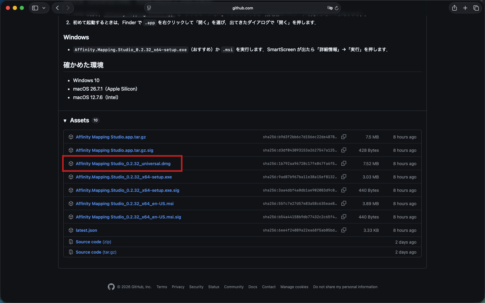

2. Safari で「"github.com" でのダウンロードを許可しますか?」と出たら，「許可」を押します．
   この画面は，そのサイトから初めてダウンロードするときにだけ出ます．

   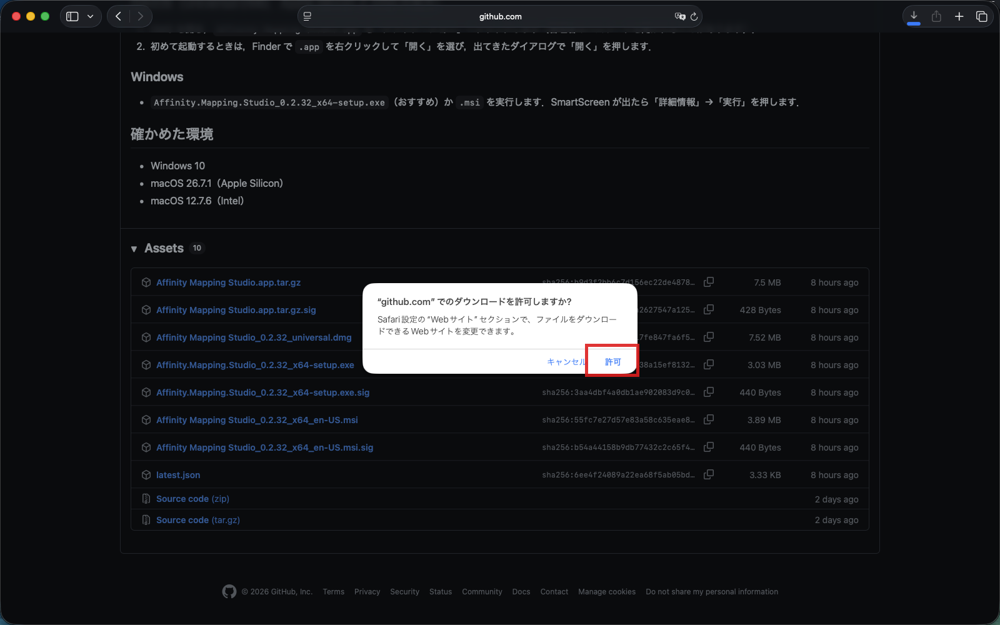

3. ダウンロードが終わったら，右上のダウンロードのボタンを押します．

   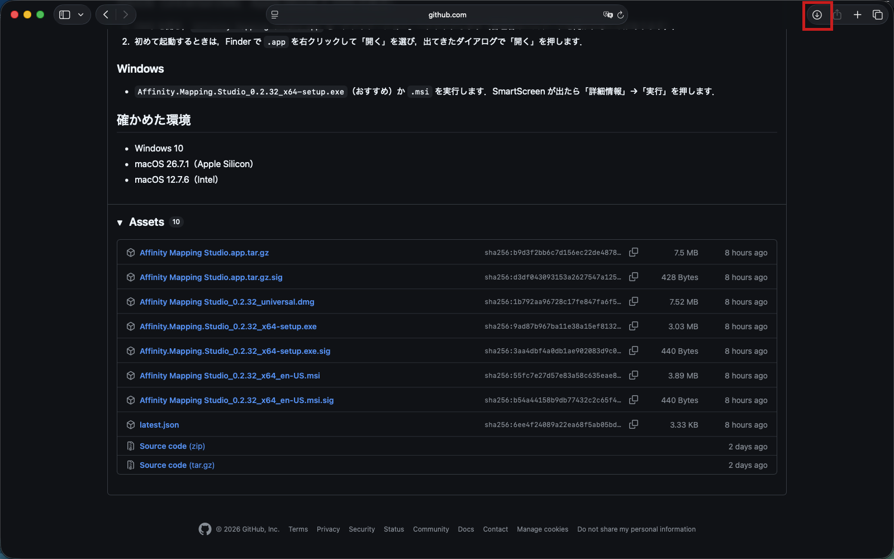

4. 一覧の `….dmg` をダブルクリックします．
   Finder で「ダウンロード」フォルダを開いて，そこにある `.dmg` をダブルクリックしても同じです．

   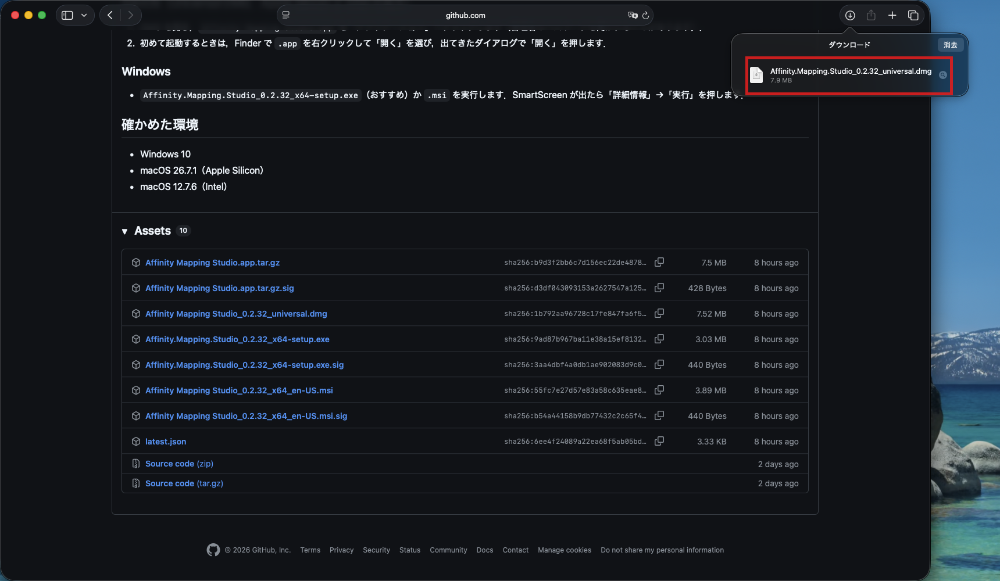

5. 窓が開きます．左の「Affinity Mapping Studio」のアイコンを，右の「Applications」のフォルダの上までドラッグして離します．

   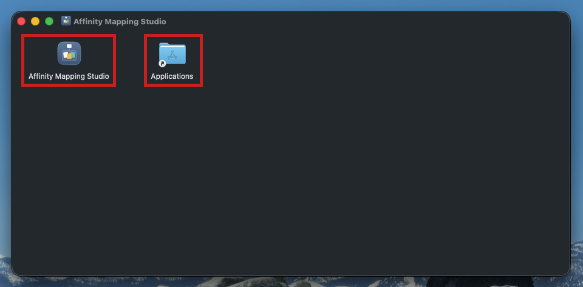

6. 管理者のユーザー名とパスワードを聞かれることがあります（Mac に標準ユーザーでログインしているとき）．
   管理者のユーザー名とパスワードを入れて，「OK」を押します．
   自分が管理者なら，この画面は出ません．

   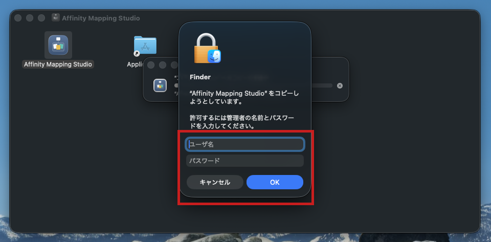

7. コピーが終わったら，Finder の左の列にある「Affinity Mapping Studio」の横の取り出しのボタン（⏏）を押して，`.dmg` を閉じます．
   ダウンロードした `.dmg` のファイルは，ゴミ箱に入れてかまいません．

### 初めて起動する

AMS には Apple の公証（ノータリゼーション）が付いていません．そのため，初めて起動するときだけ，次の手順で「開いてよい」と Mac に伝えます．
2 回目からは，ふつうにダブルクリックするだけで起動します．

1. Finder で「アプリケーション」フォルダを開き，「Affinity Mapping Studio」をダブルクリックします．

2. 「"Affinity Mapping Studio" は開いていません」と出ます．「完了」を押します．
   「ゴミ箱に入れる」は押しません（押すとアプリが消えます）．

   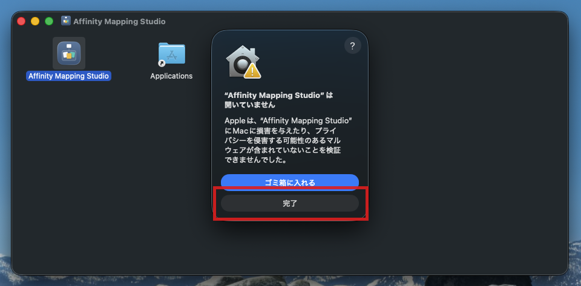

3. アップルメニュー（画面の左上のりんごのマーク）→「システム設定」→「プライバシーとセキュリティ」を開きます．
   右側をいちばん下のほうまで送ると，「セキュリティ」の欄に「お使いの Mac を保護するために "Affinity Mapping Studio" がブロックされました．」と出ています．
   その横の「このまま開く」を押します．

   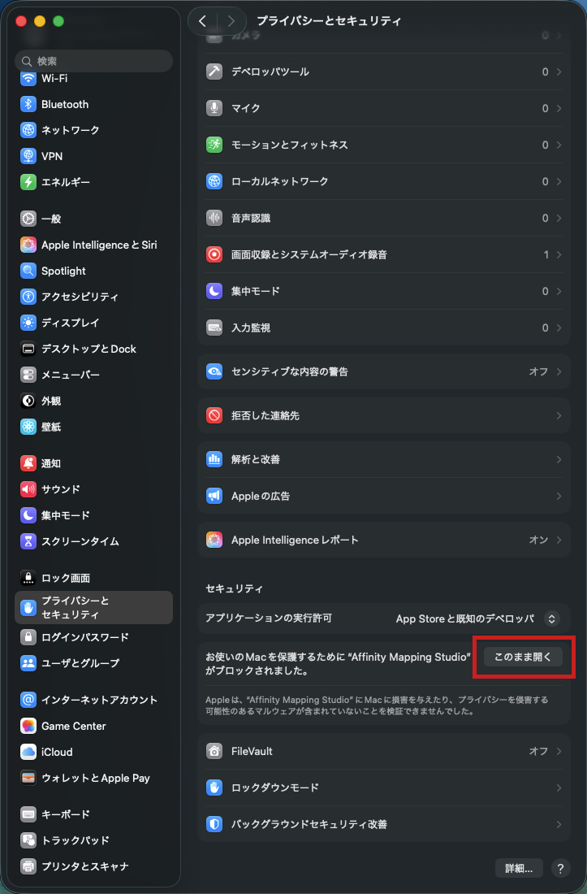

   この表示は，手順 2 のあと 1 時間ほどで消えます．見当たらないときは，もう一度手順 1 からやり直します．

4. 「"Affinity Mapping Studio" を開きますか?」と出ます．「このまま開く」を押します．

   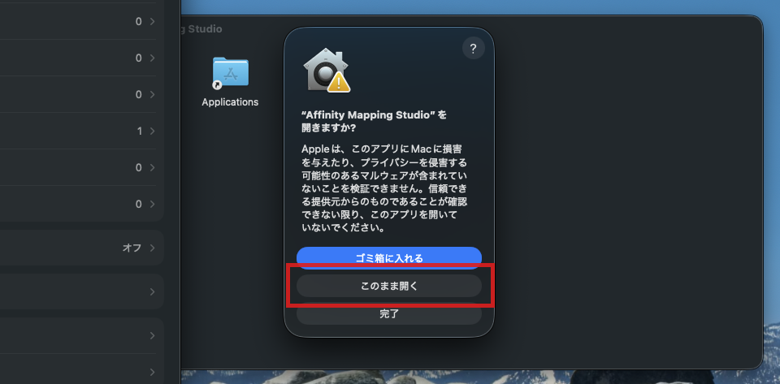

5. ユーザー名とパスワードを聞かれます．Mac にログインするときのパスワード（標準ユーザーなら，管理者のユーザー名とパスワード）を入れて，「OK」を押します．
   Touch ID のある Mac では，指で済むこともあります．

   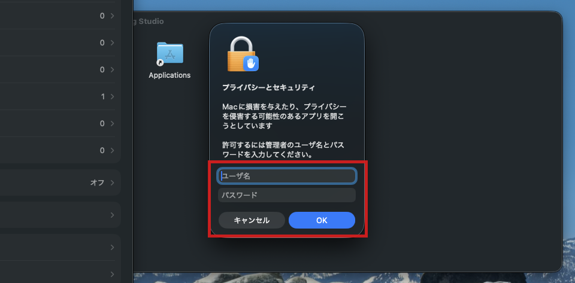

6. AMS が起動します．この画面が出れば，インストールは終わりです．

   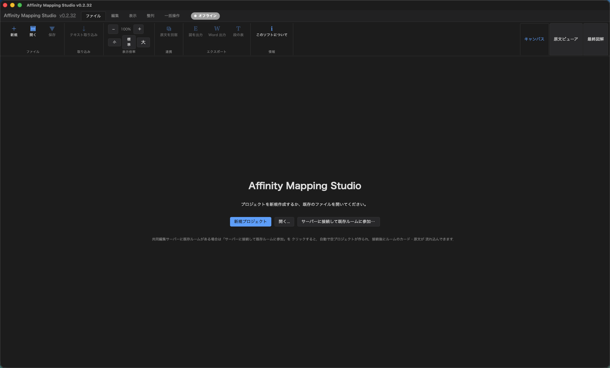

続きは [02 チュートリアル](02-tutorial.md) です．

### 古い macOS の場合

macOS 14（Sonoma）以前では，手順 2〜5 の代わりに，次の手順で開けます．

1. Finder で「アプリケーション」フォルダを開き，「Affinity Mapping Studio」を**右クリック**します（トラックパッドなら 2 本の指でクリック，または control キーを押しながらクリック）．
2. メニューの「開く」を押します．
3. 「開いてもよろしいですか?」と出たら，「開く」を押します．

AMS は macOS 12（Monterey）以降で動きます（macOS 12.7.6 の Intel の Mac で確かめました）．

### 「壊れているため開けません」と出る場合

「ターミナル」（アプリケーション → ユーティリティ）を開き，次の 1 行を貼り付けて return キーを押してから，もう一度開いてください．

```bash
xattr -dr com.apple.quarantine "/Applications/Affinity Mapping Studio.app"
```

### アンインストール

「アプリケーション」フォルダの「Affinity Mapping Studio」をゴミ箱へ入れます．
自分で保存したプロジェクトのファイル（`.kjproj`）は消えません．

## Windows（.exe）

<!-- TODO: 写真は v0.2.30 のもの．iiyama で v0.2.32 の画面に撮り直して images/win-*.png に差し替える -->

### インストール

1. Assets の一覧で `…_x64-setup.exe` を押して，ダウンロードします．

   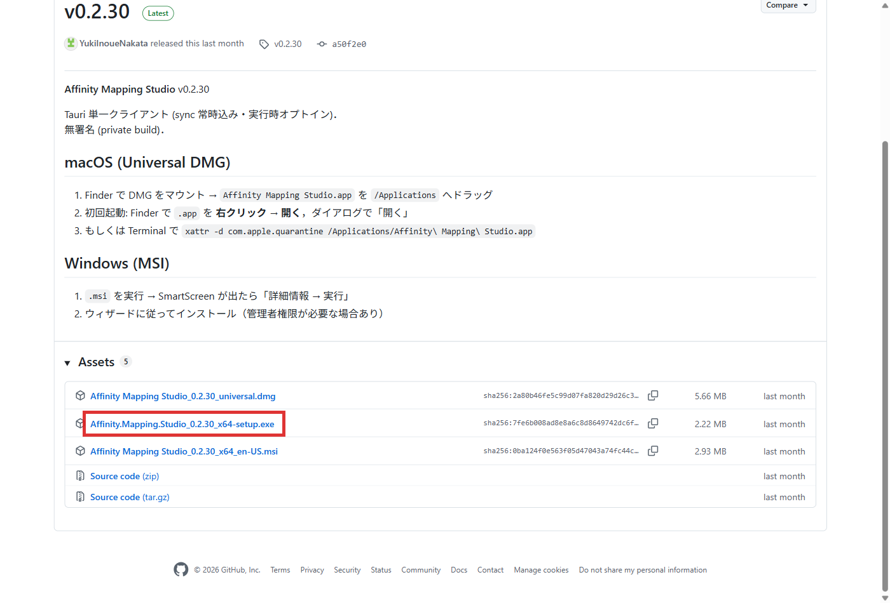

2. ダウンロードしたファイルをダブルクリックします．

   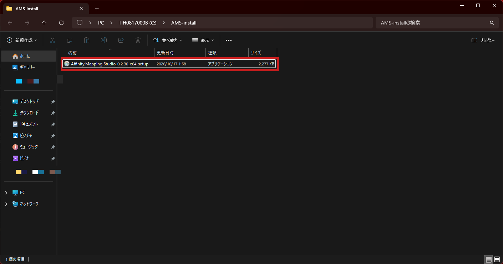

3. 「Windows によって PC が保護されました」と出たら，「詳細情報」を押します．
   アプリに電子署名が付いていないため，この画面が出ます．

   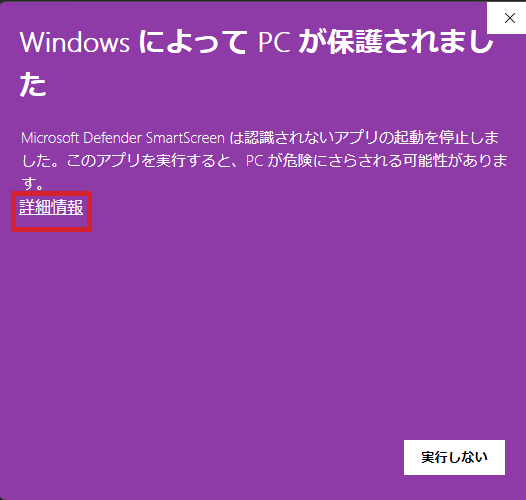

4. 「実行」を押します．

   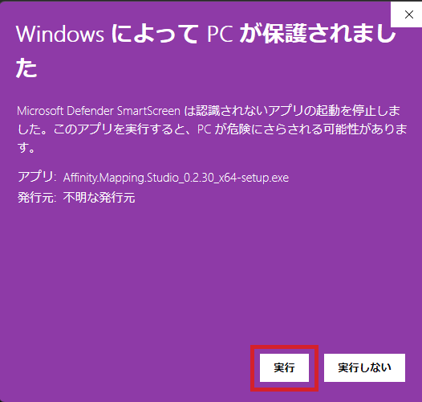

5. 「セットアップへようこそ」の画面で「次へ」を押します．

   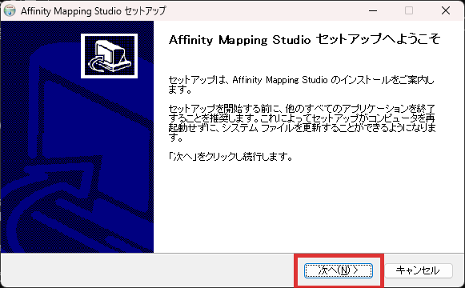

6. インストール先はそのままで，「次へ」を押します．

   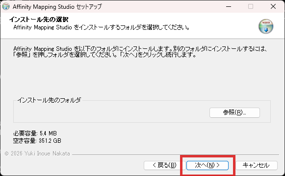

7. 「スタートメニュー（すべてのアプリ）に登録しますか？」と聞かれたら，ふつうは「はい」を押します．

   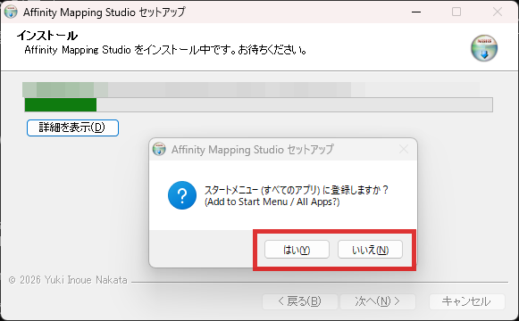

8. 「インストールの完了」と出たら，「次へ」を押します．

   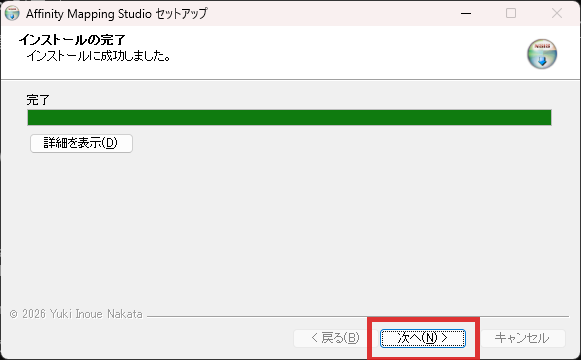

9. 「完了」を押します．「Affinity Mapping Studio を実行」にチェックがあれば，そのまま起動します．

   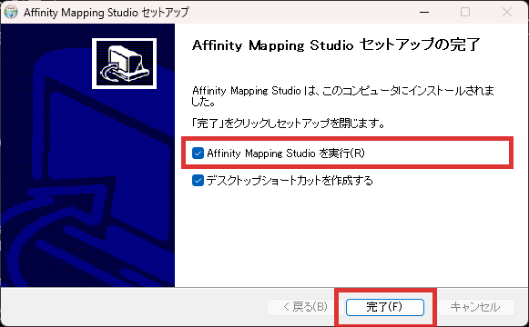

### 起動

スタートメニューを開いて「Affinity」と入力し，「Affinity Mapping Studio」を押します．
デスクトップのショートカットを作った場合は，それをダブルクリックしても起動します．

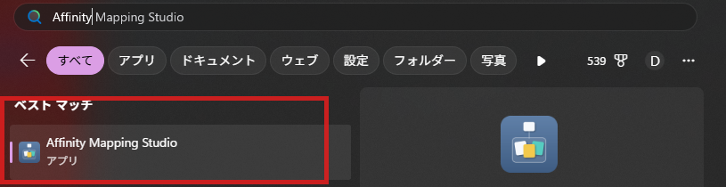

### アンインストール

1. 「設定」→「アプリ」→「インストールされているアプリ」で「Affinity Mapping Studio」の「…」を押し，「アンインストール」を押します．
2. アンインストールの画面で「アンインストール」を押します．
   「アプリケーションデータを削除する」にチェックを入れると，アプリが手元に置いているデータ（設定や，共同編集のために手元に残しているコピー）も消えます．
   自分で保存したプロジェクトのファイル（`.kjproj`）は消えません．入れ直すつもりなら，チェックは入れないでおきます．

   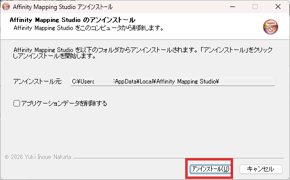

## Windows（.msi）

### インストール

1. Assets の一覧で `…_x64_en-US.msi` を押して，ダウンロードします．
2. ダウンロードしたファイルをダブルクリックします．「Windows によって PC が保護されました」と出たら，`.exe` のときと同じく「詳細情報」→「実行」を押します．
3. 画面の指示に従って「Next」を押していきます．管理者の権限を求められたら「はい」を押します．

### アンインストール

「設定」→「アプリ」→「インストールされているアプリ」で「Affinity Mapping Studio」の「…」を押し，「アンインストール」を押します．

## 新しい版に上げる

v0.2.32 からは，アプリが起動したときに新しい版があるかを確かめます（1 日に 1 回まで）．
新しい版があれば知らせが出るので，「更新する」を押すと，ダウンロードから入れ直しまでをアプリが行います．
入れる前に，配布物に付いた署名を確かめるので，途中で別のファイルにすり替わることはありません．

v0.2.31 以前を使っている場合は，この仕組みがまだ入っていません．今回だけ，上の手順で新しい版を入れ直してください．
入れ直しても，自分で保存したプロジェクトのファイル（`.kjproj`）はそのまま使えます．
