# 02 チュートリアル（取り込みから保存まで）

短い自由記述の回答（15 行）を取り込み，6 枚をカードにして，似たカードを 2 つのグループにまとめ，親和図を保存して画像に書き出すまでを，通して行います．
赤い枠のところを順に押していけば進めます．30 分ほどで終わります．

AMS をまだ入れていない人は，先に [01 入れる・起動する](01-install.md) を見てください．

- [練習用の文章を用意する](#練習用の文章を用意する)
- [新しいプロジェクトを作る](#新しいプロジェクトを作る)
- [画面の各部の名前](#画面の各部の名前)
- [文章を取り込む](#文章を取り込む)
- [文章からカードを作る](#文章からカードを作る)
- [カードをキャンバスに並べる](#カードをキャンバスに並べる)
- [似たカードをグループにする](#似たカードをグループにする)
- [段のタブで見る](#段のタブで見る)
- [保存する](#保存する)
- [図に書き出す](#図に書き出す)

[マニュアルの目次へ](README.md)

## 練習用の文章を用意する

次の 15 行を，テキストファイル（例: `cards.txt`）に保存します．
Mac では「テキストエディット」で，「フォーマット」→「標準テキストにする」にしてから保存します．Windows では「メモ帳」で保存します．
保存する場所は，あとで見つけやすいところ（例: 「書類」（ドキュメント）の中に作った `AMS-guide` フォルダ）にします．

<details>
<summary>練習用の文章（cards.txt）</summary>

```text
朝の授業に間に合うように起きるのがつらい
レポートの締切が重なると徹夜になる
図書館の席がすぐ埋まってしまう
サークルの先輩に相談できて安心した
アルバイトのシフトと授業が重なる
友だちと一緒に勉強すると続けやすい
通学の電車が混んでいて疲れる
奨学金の手続きが分かりにくい
ゼミの発表で緊張して話せなかった
学食のメニューが少ない
オンライン授業は自分のペースで進められる
将来の仕事についてまだ決められない
一人暮らしで食事が偏りがち
先生に質問しやすい雰囲気だと助かる
休日に何もしないで終わってしまう
```

</details>

## 新しいプロジェクトを作る

1. AMS を起動すると，次の画面が出ます．「新規プロジェクト」を押します．

   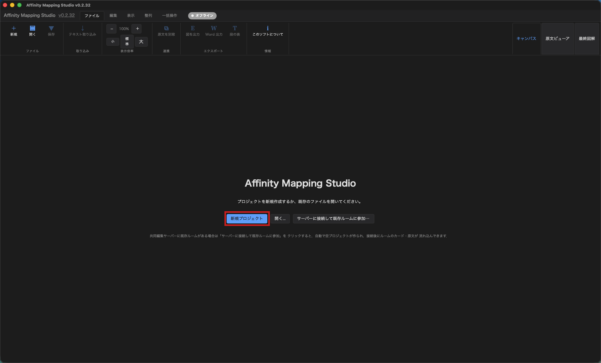

2. 「プロジェクト名」の欄に名前（ここでは「学生生活の悩み」）を入れて，「作成」を押します．

   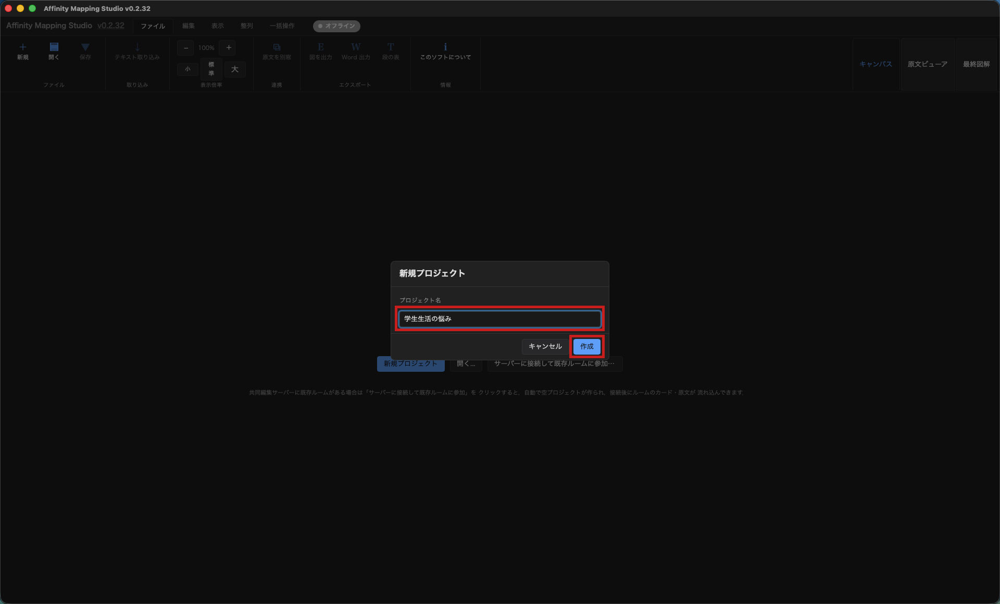

## 画面の各部の名前

プロジェクトを作ると，次の画面になります．番号は下の表に対応しています．

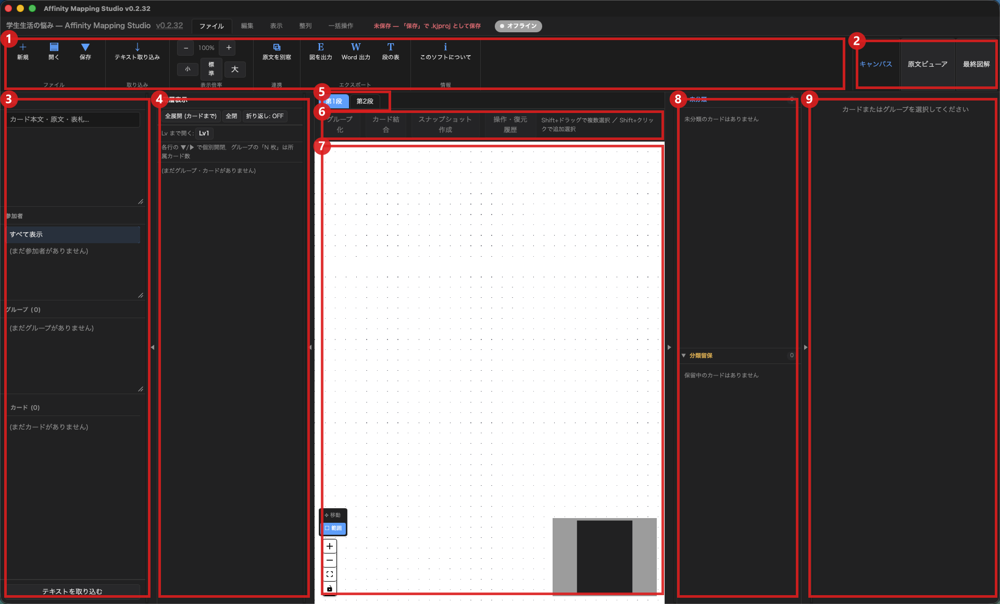

| 番号 | 名前 | 何をするところか |
|---|---|---|
| 1 | ツールバー | 新規・開く・保存，テキストの取り込み，表示の倍率，図や Word への書き出し．上の「ファイル」「編集」「表示」「整列」「一括操作」のタブで中身が替わります |
| 2 | 表示の切り替え | 「キャンバス」（親和図を作る画面），「原文ビューア」（取り込んだ文章），「最終図解」 |
| 3 | 左の欄 | 検索，参加者，グループとカードの一覧 |
| 4 | 階層表示 | グループの入れ子を一覧で見る |
| 5 | 段のタブ | 「第1段」「第2段」…で，その段のまとまりを表示する（[段のタブで見る](#段のタブで見る)） |
| 6 | カードの操作 | 選んだカードのグループ化・結合など |
| 7 | キャンバス | カードを並べて親和図を作る場所 |
| 8 | 未分類・分類留保 | まだキャンバスに置いていないカードの置き場 |
| 9 | 詳細 | 選んだカードやグループの中身を見る・直す |

画面が狭いときは，各欄の境目にある ◀ / ▶ のボタンで欄を畳めます．畳んだ欄は，もう一度押すと元に戻ります．

## 文章を取り込む

1. ツールバーの「テキスト取り込み」を押します．

   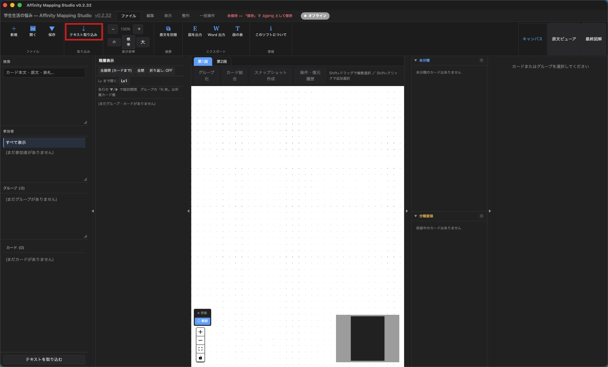

2. 「原文取り込みウィザード」が開きます．5 つの段階を順に進みます．まず「ファイルを選択...」を押します．
   テキストのほか，Markdown・Word（.docx）・Excel（.xlsx）・CSV も取り込めます．

   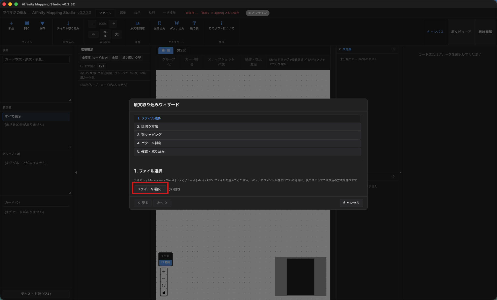

3. ファイルを選ぶ画面で，用意した `cards.txt` を選び，「Open」（開く）を押します．
   Mac では，この画面のボタンが英語で出ることがあります．

   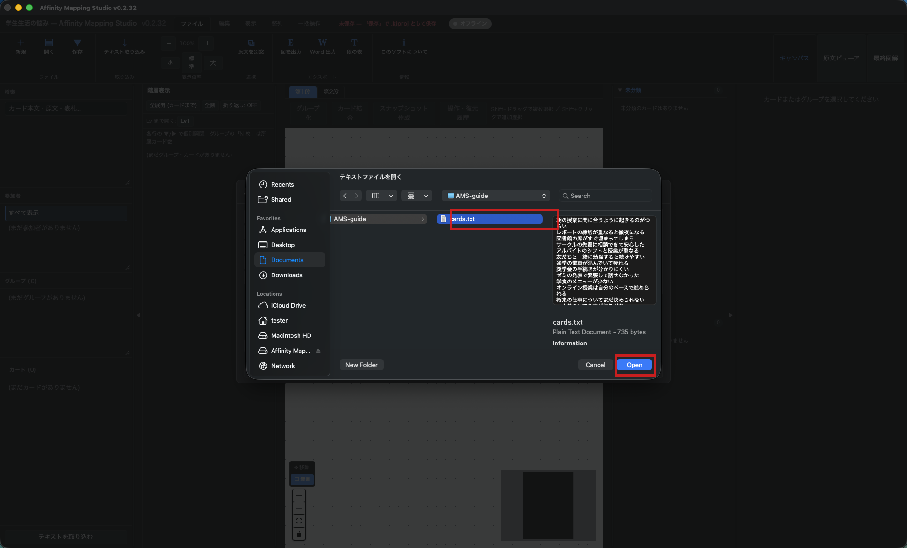

4. ファイルの中身の先頭が「先頭プレビュー」に出ます．「次へ」を押します．

   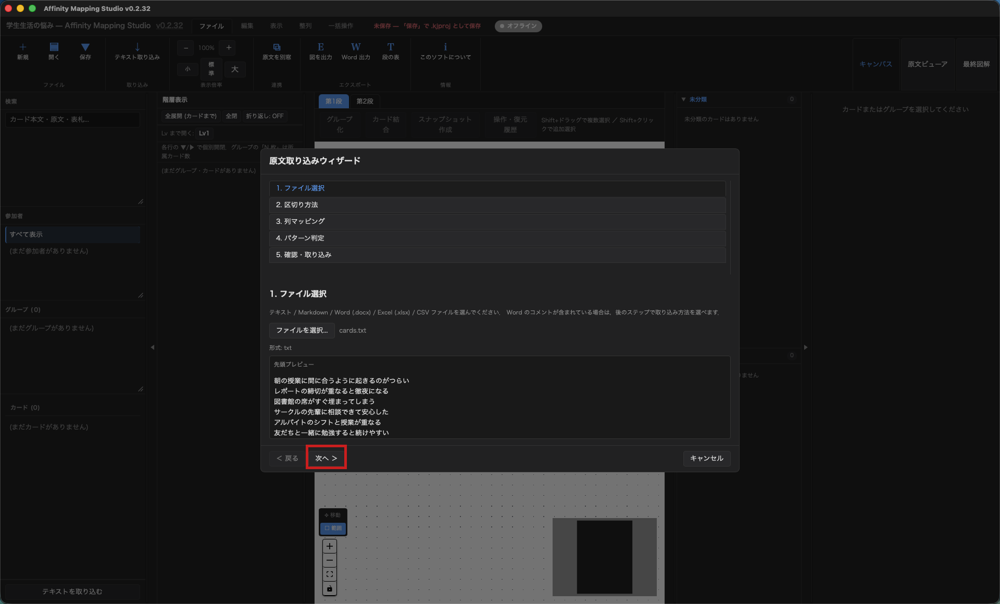

5. 「2. 区切り方法」は，最初の「行で区切り（1 行＝1 セグメント）」のままにします．1 行が 1 つのまとまり（セグメント）になります．
   「ヘッダ一行」が「なし」になっていることを確かめて，「次へ」を押します．「あり」だと，1 行目が見出しとして扱われ，取り込まれません．

   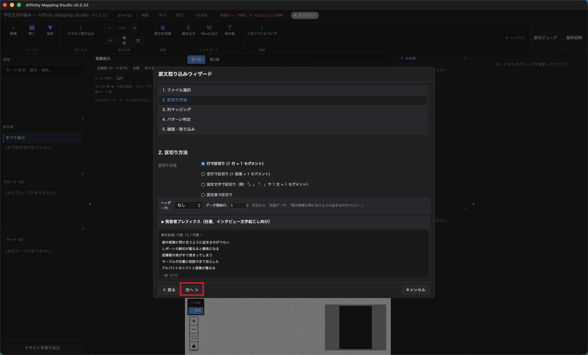

6. 「3. 列マッピング」は，そのままで「次へ」を押します．列 1 が「本文」になっています．

   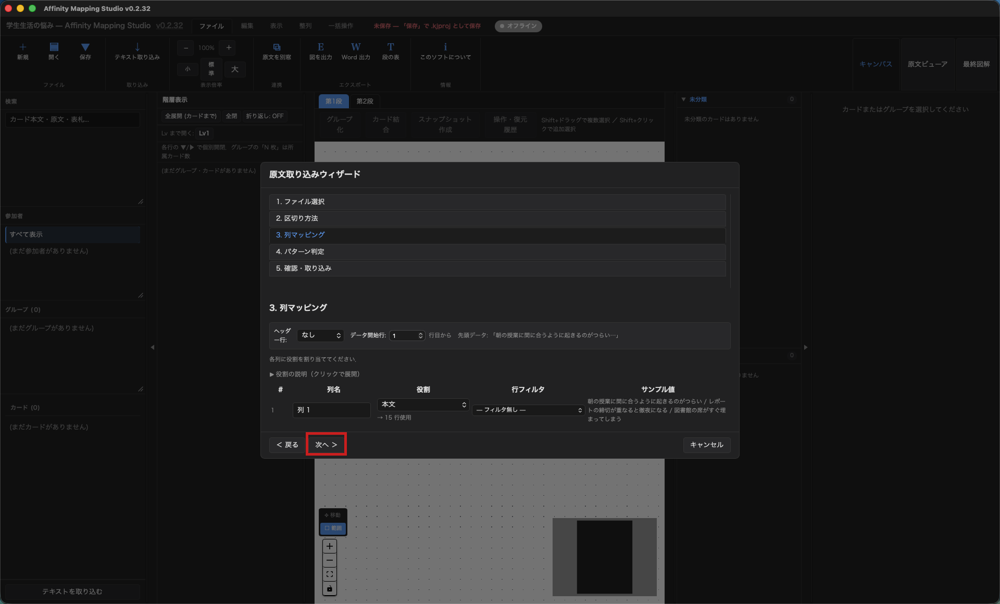

7. 「4. パターン判定」は，「インタビュー型」のままで「次へ」を押します．参加者のコード（`P01`）は自動で入ります．

   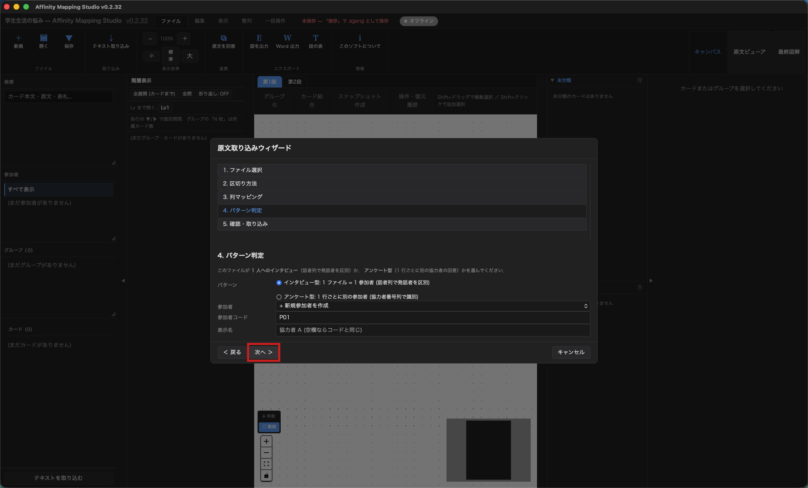

8. 「5. 確認・取り込み」で，「取り込み対象行 15 行」となっていることを確かめて，「取り込む」を押します．

   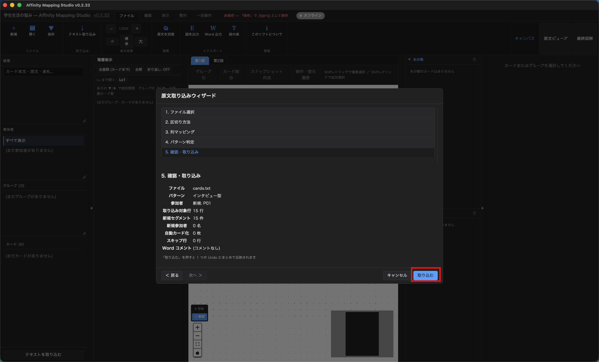

## 文章からカードを作る

KJ 法では，文章を意味のまとまりごとに切り出して，1 枚ずつカードにします．

1. 取り込みが終わると，「原文ビューア」の窓が開き，文章が 1 行ずつ並びます．この時点では，まだカードにはなっていません（「未カード化」と出ています）．
   カードにしたい文を選びます．ここでは，1 行目から 6 行目までの 6 つを選びます．
   1 行目の文を押し，**Shift キーを押しながら** 6 行目の文を押すと，その間の文がまとめて選ばれます．

   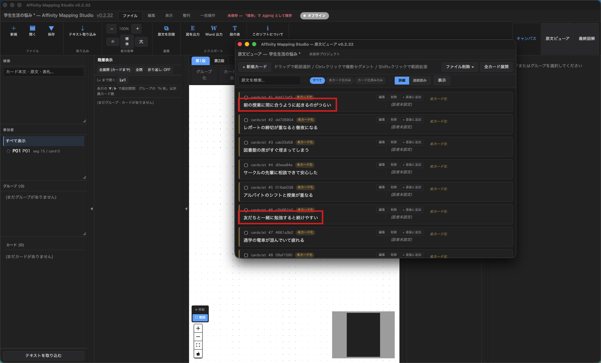

   - 離れた文を 1 つずつ選び足したいときは，Mac では **command キー**，Windows では **Ctrl キー**を押しながら押します．
   - 文の一部だけをカードにしたいときは，マウスでなぞって選びます．なぞり始めた位置からカードになるので，文の頭から選びたいときは，文の左端からなぞってください．

2. 選ぶと，上に「カード化」と「セグメントごとにカード化」のボタンが出ます．「セグメントごとにカード化（6 枚）」を押します．

   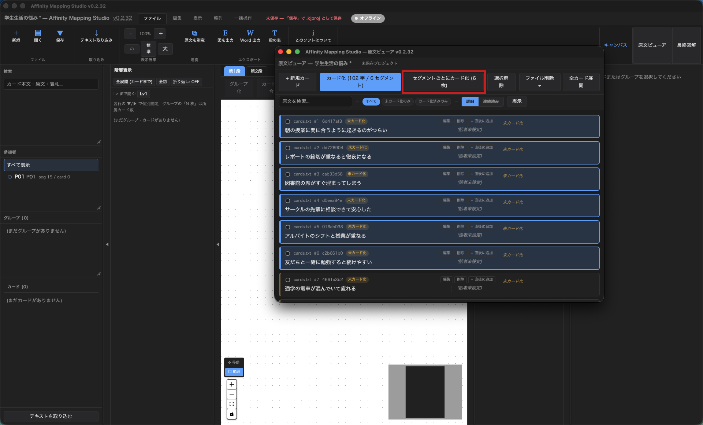

   「セグメントごとにカード化」は，選んだ文を 1 つずつ別のカードにします．「カード化」は，選んだ範囲をまとめて 1 枚のカードにします．

3. 6 枚のカード（P01-001〜P01-006）ができました．原文ビューアの窓は，左上の閉じるボタン（Mac は赤い丸，Windows は右上の ×）で閉じます．
   原文ビューアは，ツールバーの右の「原文ビューア」を押すと，いつでもまた開けます．

   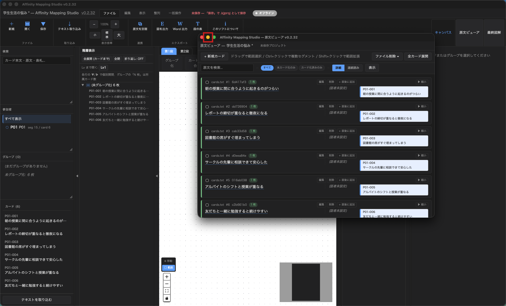

> 原文に無いことを書き足したいときは，原文ビューアの「+ 新規カード」を押して，本文を入力し「作成」を押します．できたカードは「未分類」に入ります．

## カードをキャンバスに並べる

1. 作ったカードは，右の「未分類」に入っています．カードの「キャンバスへ」を押すと，そのカードがキャンバスに置かれます．6 枚とも置きます．
   カードを未分類からキャンバスへドラッグしても置けます．

   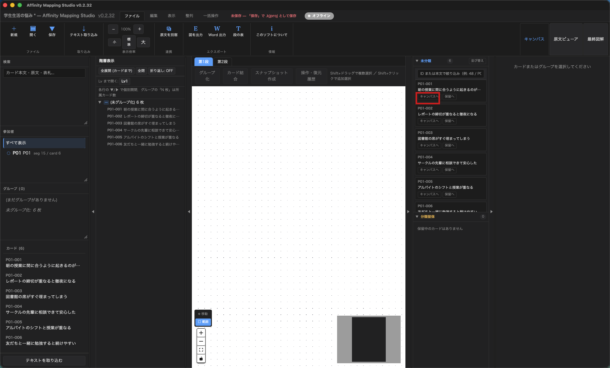

2. 置いたカードは，少しずつずれて重なっています．

   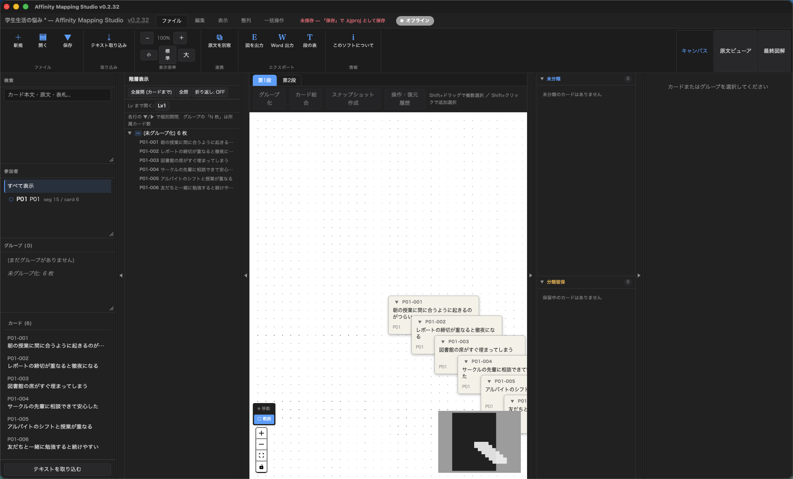

3. カードの上の見出し（「▼ P01-001」など）をつかんでドラッグすると，カードを動かせます．似ていると思うカードを近くに寄せていきます．
   ここでは，授業や課題と時間の悩み（001・002・005）を左に，人とのつながり（004・006）を右に，図書館（003）を離れたところに置きました．
   キャンバスの左下の「全体を表示」（四角いボタン）を押すと，全体が画面に収まります．

## 似たカードをグループにする

1. まとめたいカードを選びます．1 枚目を押し，2 枚目からは **Shift キーを押しながら**押します．ここでは 001・002・005 の 3 枚を選びます．

   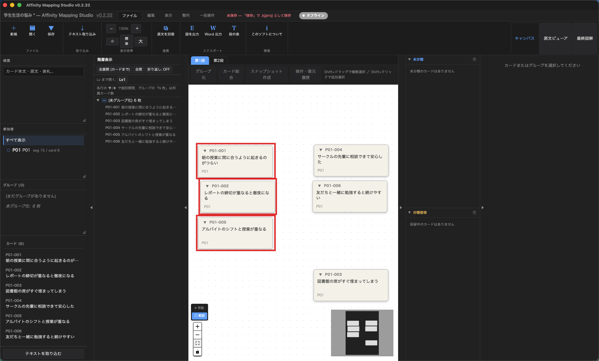

2. 上の「グループ化（3 枚）」を押します．

   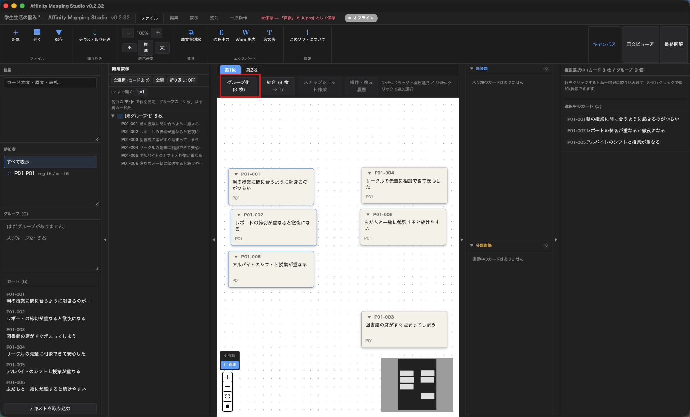

3. 3 枚が 1 つのグループの枠に入ります．はじめは「グループレベル1 1」のような仮の名前が付いています．
   グループの枠の見出しを押します．

   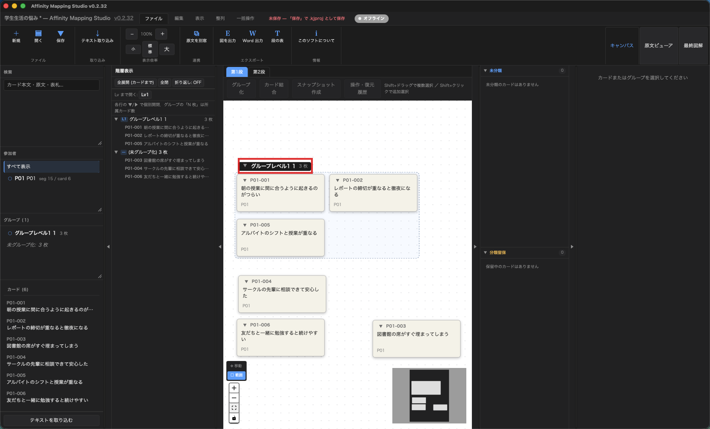

   グループを作ると，枠の中のカードが並べ直されます．枠がほかのカードにかぶさったときは，そのカードを枠の外へドラッグします．

4. 右の「グループ詳細」に「表札」の欄が出ます．表札は，そのまとまりが何を言っているかを一言で書いたものです．
   欄を押して表札（ここでは「授業・課題と時間のやりくり」）を書き，Enter キー（Mac は return キー）で確定します．

   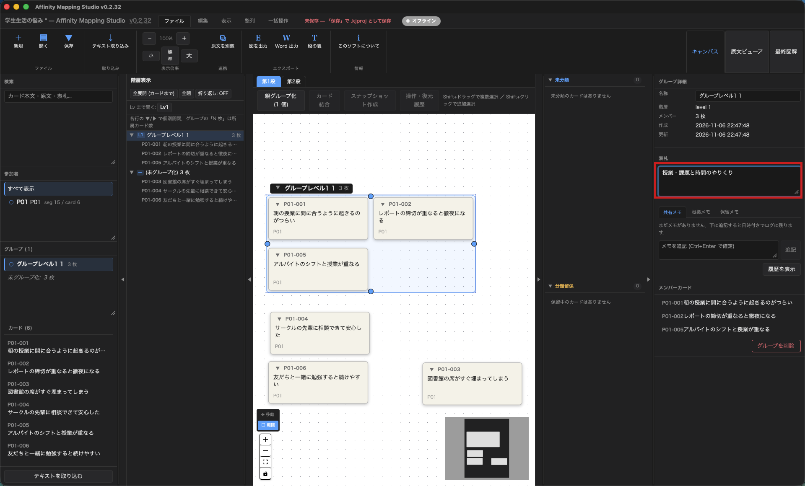

5. 同じようにして，004・006 の 2 枚を「人とのつながり・支え」のグループにします．
   グループに入れないカード（ここでは 003）があってもかまいません．

   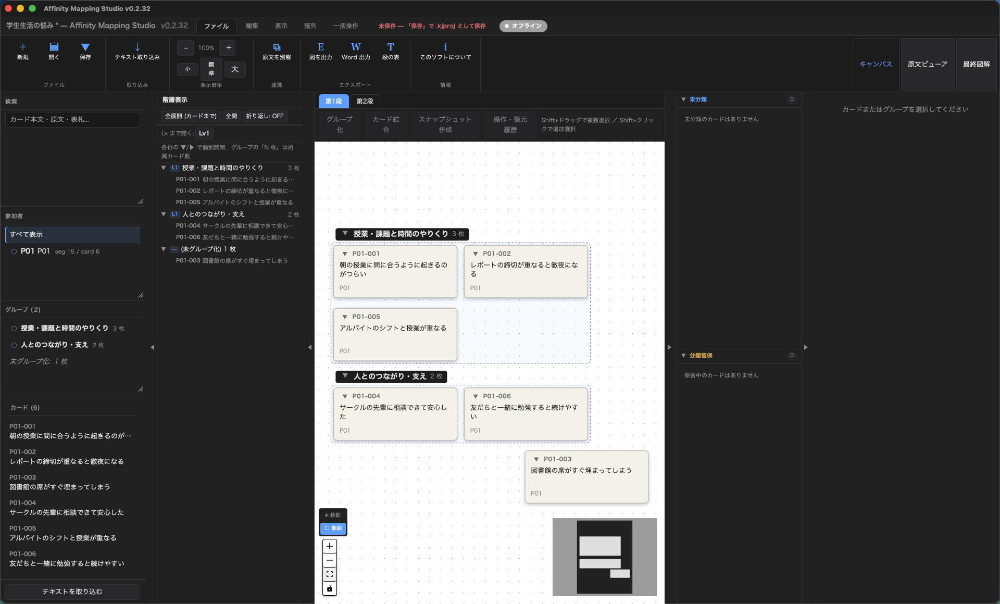

## 段のタブで見る

キャンバスの上の「第1段」「第2段」のタブで，段ごとの表示に切り替えられます．
「第2段」を押すと，第 1 段で作ったグループが 1 つずつの箱として出ます．グループが増えてきたら，この箱をさらにまとめて，第 2 段のグループを作っていきます．
詳しくは「06 段のタブと段の表」（準備中）で説明します．

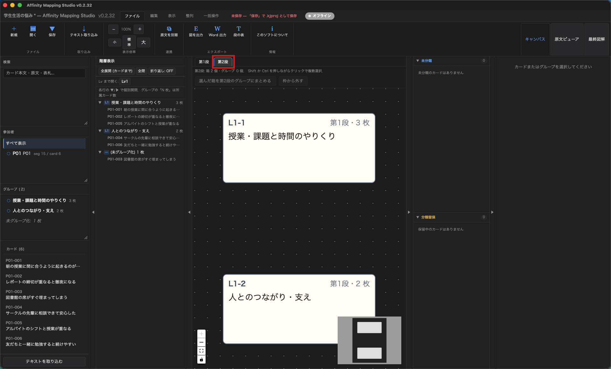

確かめたら，「第1段」のタブに戻ります．

## 保存する

1. ツールバーの「保存」を押します．

   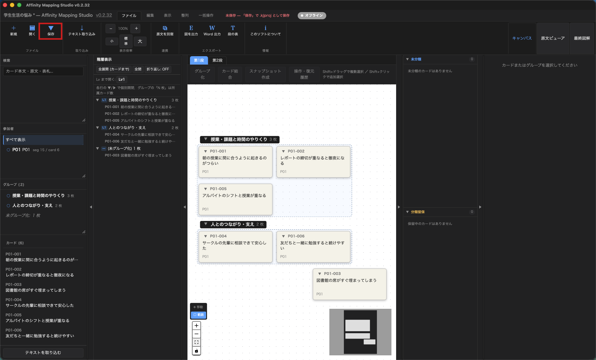

2. 保存先とファイル名を決めて，「Save」（保存）を押します．
   `.kjproj` という形式のファイルができます．次からはツールバーの「開く」で開けます．

   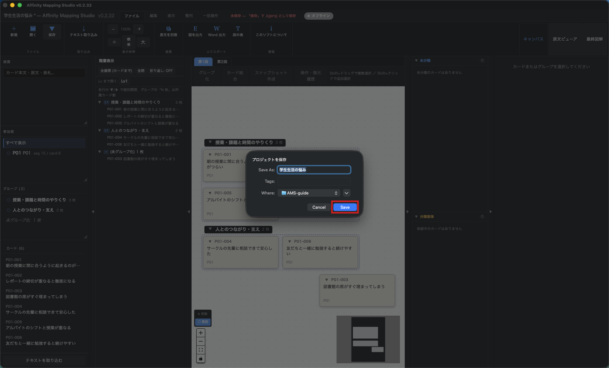

   一度保存すると，その後の変更は自動で保存されます（画面の上に「自動保存 ON」と出ます）．

## 図に書き出す

1. ツールバーの「図を出力」を押すと，親和図を画像（PNG）・PDF・SVG にできます．
   となりの「Word 出力」を押すと，質問に答えながら，分析の方法・結果（グループの階層と表札，カード）・考察の段落を組み立て，論文や報告の下書きを Word の文書にできます．

   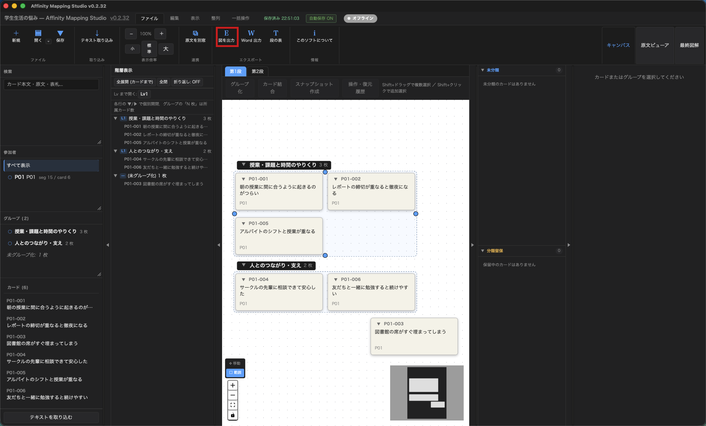

2. 「キャンバスをエクスポート」の画面で，形式（ここでは PNG）を選んで「プレビュー生成」を押します．

   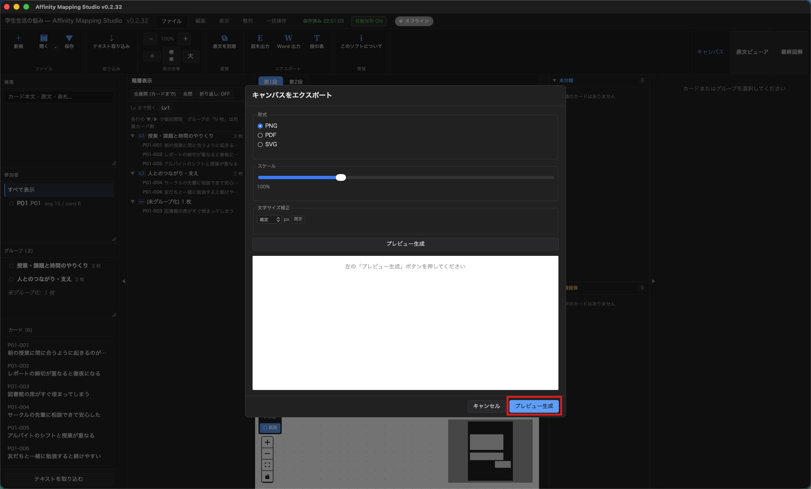

3. 出来上がりを確かめて，「PNG で保存」を押します．

   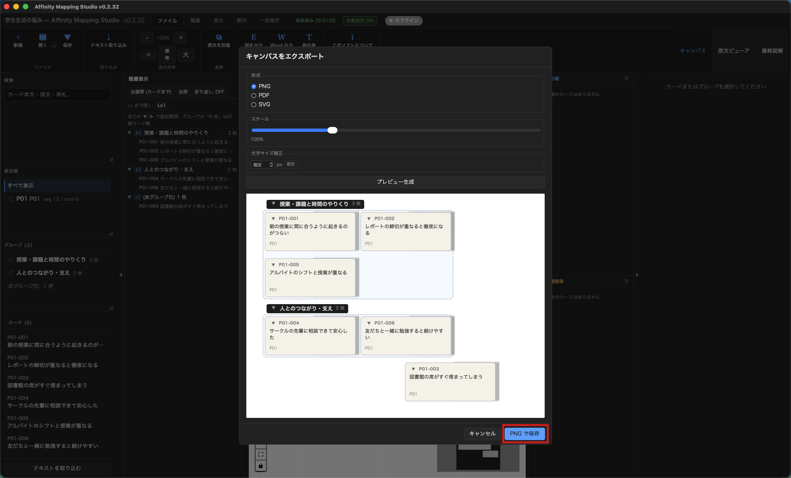

4. 画像は「ダウンロード」フォルダに保存されます（ファイル名は「プロジェクト名_日時.png」）．
   Mac で初めて保存するときは，「"ダウンロード" フォルダ内のファイルへのアクセス権を求められています」と出ます．「許可」を押します．

   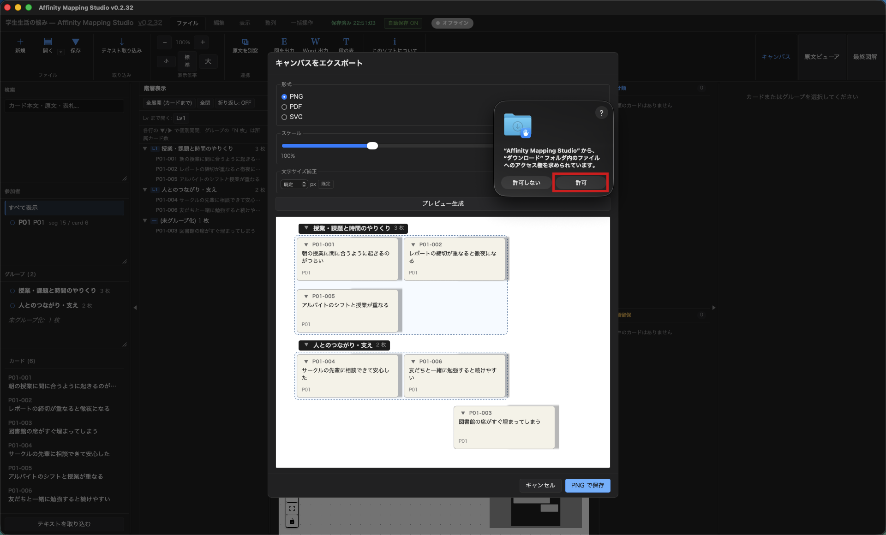

   保存が終わったら，「キャンセル」を押してエクスポートの画面を閉じます．

これで，最初の親和図ができました．
カードの作り方やグループのまとめ方をもっと知りたいときは，[マニュアルの目次](README.md)から各章を見てください．
